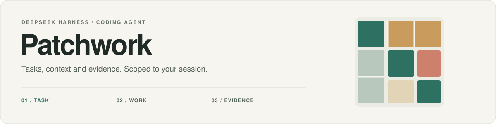
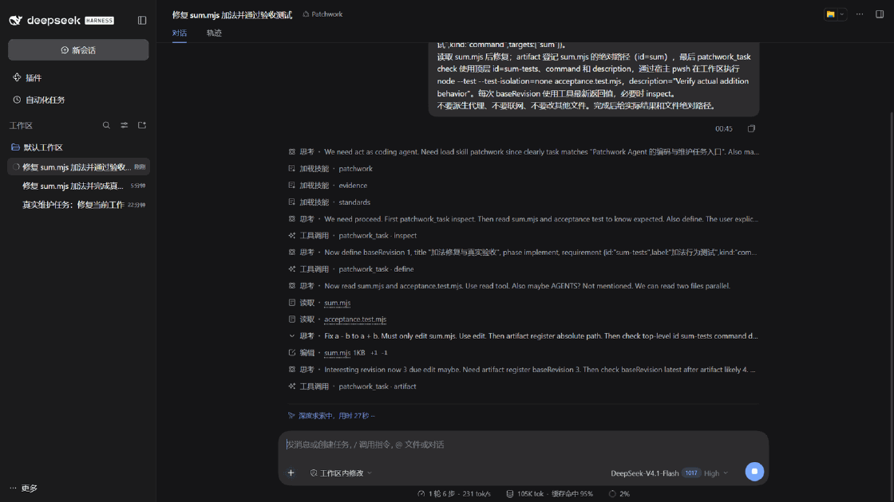
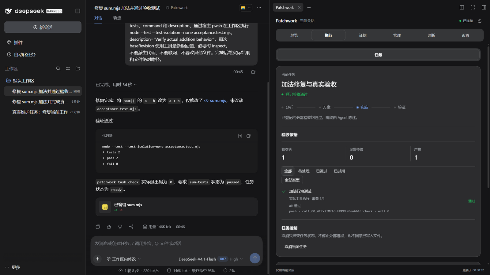
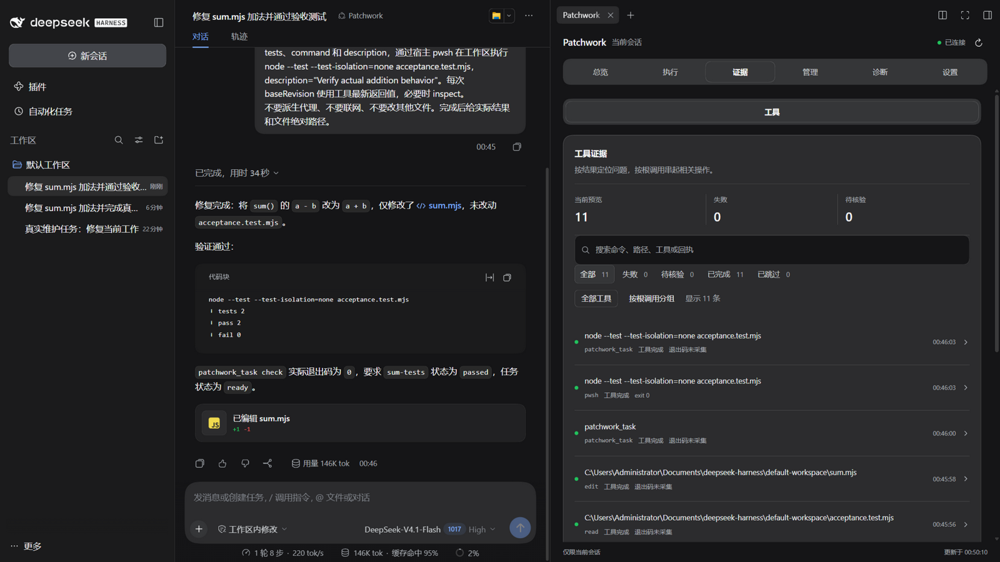

<div align="center">

<picture>
  <source media="(prefers-color-scheme: dark)" srcset="docs/assets/readme/hero-dark.svg">
  
</picture>

<p><strong>模型说"做完了"，不算数。<br>Patchwork 让每次交付都带着可验证的证据。</strong></p>

<p><strong>简体中文</strong> · <a href="README_EN.md">English</a></p>

<p>
  <a href="https://github.com/ADWMC/Patchwork/actions/workflows/validate.yml"></a>
  <a href="https://github.com/ADWMC/Patchwork/actions/workflows/codeql.yml"></a>
  <a href="LICENSE"></a>
  <a href="https://github.com/ADWMC/Patchwork/releases"></a>
</p>

<p>
  <a href="#why">为什么需要它</a> ·
  <a href="#quick-start">快速开始</a> ·
  <a href="#capabilities">功能</a> ·
  <a href="#optional-browser">可选浏览器</a> ·
  <a href="#boundaries">使用边界</a> ·
  <a href="#docs">文档</a> ·
  <a href="#community">参与</a>
</p>

</div>

---

Patchwork 是 **DeepSeek Harness（DSH）的代码任务插件**。它把任务要求、用户纠正、工具回执和验收结果放进同一条工作流，让编码 Agent 的每一步交付都有据可查。

选择 **Patchwork Agent** 后启用专属能力；其他模式继续使用宿主自己的工具与会话。

**真机实录**：DeepSeek V4.1 Flash 在隔离 DSH 实例中完成一个 34 秒的真实维护任务——修 `sum.mjs` 加法错误 → `patchwork_task` 登记要求与产物 → 宿主 `node --test` 验收通过，工作台同步显示每一步回执：



<details>
<summary>工作台静帧：执行视图 / 证据视图</summary>





</details>

<a id="why"></a>

## 为什么需要它

编码 Agent 最常见的三类失败，Patchwork 用内置机制回应：

| 你可能遇到过 | Patchwork 的做法 |
| :--- | :--- |
| 模型声称"完成"，你还是要逐项人工复查 | **验收绑定真实宿主回执**：失败、过期与未覆盖的结果不算通过，任务要求、阶段与产物登记在 `patchwork_task` |
| 纠正之后上下文丢失，同一个问题反复解释 | **纠正使旧证据失效**并触发重新核对；只读 `handoff` 提供有界交接，不必整段重放历史 |
| 项目约定和你的偏好反复丢失 | **显式记忆**：会话私有与项目共享分开确认，带版本校验、来源历史与批量遗忘；自动注入默认关闭 |

再加几件开箱即用的事：`patchwork_search` 免密钥并行搜索 Bing（RSS 输出）、Brave、DuckDuckGo；`patchwork_code` 在工作区内做仓库地图、符号定义与词法引用检索；`patchwork_superagent` 提供持久队列、依赖与有界重试的主控；6 视图原生工作台覆盖任务、证据、日志与 26 项设置。

> **改进的依据是用户实际遇到的失败和纠正。** 候选规则、记忆策略与工具流程需要隔离验证和用户确认；确认后仅在本会话实际应用，并可回滚恢复。契约通过不代表模型质量提升。

<a id="quick-start"></a>

## 快速开始

### 方式一：安装已发布的包（推荐）

从 [Releases](https://github.com/ADWMC/Patchwork/releases) 下载 `patchwork-coding-agent-<版本>.tgz`，安装到**已初始化并配置好模型**的 DSH 实例。试用建议使用独立实例。

```powershell
$env:DSH_HOME = 'C:\dsh\patchwork-demo'
dsh plugin --profile web add C:\downloads\patchwork-coding-agent-1.0.0.tgz
```

Patchwork 复用宿主的模型与权限设置。兼容 `DSH >=0.2.1-rc.2 <0.3.0-0`：0.2.1-rc.2、0.2.1-rc.5 与 0.2.2-alpha.3 已通过同一套 **452 项测试**；旧于 rc.2 或高于 0.2.x 的宿主会被 `engines.dsh` 拒绝。设置页内置"检查更新"，手动查询 GitHub 最新 Release，不自动检查、不发送凭据。

### 方式二：从源码打包

<details>
<summary>需要已安装的 DSH、Node.js 22+ 和 pnpm 12.4.2（Windows + PowerShell）</summary>

```powershell
git clone https://github.com/ADWMC/Patchwork.git
cd Patchwork
pnpm install --frozen-lockfile
pnpm build:client
npm run pack:local -- --pack-destination "$env:TEMP/patchwork-pack"
```

该步骤只制作本地安装包，不发布到 npm。其他宿主版本可让 `dsh plugin add` 直接创建 profile，或在源码检出运行 `node scripts/set-dsh-version.mjs <version> --install`。

</details>

### 选择 Agent，打开面板

1. 重新加载目标 DSH，在新会话的 Agent 选择器中选择 **Patchwork**。
2. 从右侧栏"开始"打开 **Patchwork** 面板：当前任务、验收、日志与设置。
3. 用 `/patchwork-task` 查看任务，用 `/patchwork-superagent` 查看主控队列。其他 Agent 模式下面板显示锁定说明。

### 一次任务如何推进

```text
明确要求 → 调查与计划 → 实现与登记产物 → 按要求验收
                ↑                         │
                └──── 用户纠正后重新核对 ──┘
```

任务状态保存在原生 Session 中。主控执行器继承 DSH 的模型、权限、preset 与 SoL，结果只回到所属主控。

[任务与交接](docs/superagent-fusion-2026-11-01.md) · [Superagent 接入与边界](docs/superagent-native-2026-11-01.md)

<a id="capabilities"></a>

## 功能

| 能力 | 现在可以做什么 |
| :--- | :--- |
| **任务与验收** | 用 `patchwork_task` 登记要求、阶段、纠正版本和产物；验收绑定实际宿主回执，失败、过期结果与未覆盖项不算通过。 |
| **原生 Superagent** | 用 `patchwork_superagent` 管理持久队列、依赖与有界重试；默认两个读取槽，本模块在同一工作区内串行执行写任务。 |
| **按需技能** | 默认注册 7 个核心技能，可显式试用 13 技能目录；目录只提供名称与描述，正文按需读取。 |
| **信息检索** | `patchwork_search` 并行查询 Bing（RSS 输出）、Brave、DuckDuckGo 公共页面，无需 API key；`patchwork_fetch` 受控读取公开 URL。 |
| **本地代码检索** | `patchwork_code` 提供仓库地图、文件 outline、符号定义、词法引用和文本/正则检索；只在当前工作区读取，跳过依赖、构建产物和敏感文件，结果有界。工作区代码图默认关闭，模型可 `graph-enable` 写 `.patchwork/config.json`，再 `graph-start` 使用 callers/callees/impact/affected。 |
| **项目文档** | DSH 自动注入 `AGENTS.md`/`CLAUDE.md`；`patchwork_project_docs` 负责 hash/CAS 创建与更新 `AGENTS.md`、`DESIGN.md`，不静默覆盖、不授予权限。 |
| **显式记忆与改进** | 记忆管理支持搜索筛选、手动提案、版本修订、暂停恢复、来源历史、导出与批量遗忘；私有与共享分开确认，自动注入关闭。失败和纠正进入受控改进。 |
| **原生工作台** | **总览 / 执行 / 证据 / 管理 / 诊断 / 设置** 六个视图，任务 handoff 与纠正历史、主控补充输入 / 对账、记忆召回预览、独立来源对比、任务 / 主控 / 配置日志、26 项设置及恢复默认 / 导入导出；宽屏使用列表 / 详情和双列布局。 |

模型的"完成"陈述不能替代真实验收。文件结构检查也不能证明语义正确；相关未知项需要单独说明。

<details>
<summary><strong>技能目录与 SoL 上下文机制（可选配置）</strong></summary>

| 目录 | 技能 |
| :--- | :--- |
| 核心，默认启用 | `patchwork` · `anti-slop` · `architecture` · `collaborator` · `evidence` · `standards` · `web-ui` |
| 扩展，显式试用 | 在核心之外增加 `debugging` · `code-review` · `retrieval` · `documentation` · `memory` · `improvement` |

在 preset 的 `patchwork-runtime` 行配置扩展目录：

```yaml
- id: patchwork-runtime
  name: '@patchwork/coding-agent/runtime'
  config:
    skillsMode: expanded
```

`skillsMode: core` 恢复默认目录；`skillsEnabled: false` 关闭技能注册。扩展目录尚无多任务净收益证明。面板覆盖值保存在 `$DSH_HOME/patchwork/config.json`，优先于 runtime 行；配置目前按 `DSH_HOME` 共享，并非 profile 独立。

SoL 上下文机制实现参考 SoL-Pi，按机制开关启用。执行计数不等于已测得的 token、延迟或成本收益。

| 机制 | 配置键 | 默认 |
| :--- | :--- | :---: |
| 动作融合 | `actionFusion` | 开 |
| 观察归档与召回 | `observationPack` | 关 |
| 保留证据的工具结果裁剪 | `evidencePreservingReducer` | 关 |
| 在线上下文压缩 | `onlineContextCompact` | 关 |

[技能架构](docs/architecture-collaborator-skills.md) · [融合验证](docs/skills-fusion-execution-2026-10-31.md) · [配置与隔离](docs/upgrade/2026-10-29/isolation.md) · [SoL 设计依据](docs/solpi-mechanisms-design.md)

</details>

<a id="optional-browser"></a>

## 可选浏览器

**需要浏览器时，再安装 `@patchwork/browser`。** 它是独立 DSH 插件，可以不装 Patchwork 主包而单独使用，授权也独立于 Agent 会话。

浏览器提供标签页、地址栏、人工接管与元素标注，以及 Agent 用的 DOM/ARIA 快照、元素引用、条件等待和表单批处理。页面与登录状态按会话隔离，默认复用系统 Edge/Chrome。Patchwork 搜索默认走 HTTP，`transport: "browser"` 需同一 Agent 另行授权。

[安装与操作](packages/browser/README.md) · [旧版本迁移](docs/browser-optional-package-2026-11-01.md) · [搜索接入](docs/browser-runtime-integration-2026-11-01.md)

<a id="boundaries"></a>

## 使用边界

- **会话隔离不等于系统沙箱。** 切走 Patchwork 后专属能力与旧引用失效；`structured` / `strict` 任务策略不能替代 OS 沙箱或证明人类授权。
- **记忆按需读取。** 私有与项目共享记录分开确认，遗忘停止召回、保留历史与备份。网页、记忆和候选规则不能授予新权限。详见[记忆详细管理](docs/memory-management-2026-11-01.md)。
- **改进须明确确认。** 只支持本会话受限策略，切换 Agent 撤销，重启后须重新实验/确认；不训练模型或自动发布。见[闭环与验收指南](docs/closure-2026-11-01.md)。
- **公共网页搜索可能失效。** 无密钥搜索是可用性 fallback，没有 provider SLA；抓取保留 DNS/SSRF、host、robots、大小与超时限制，外部内容视为不可信数据。
- **诊断有内容边界。** 日志不复制提示词、完整命令或工具原文；原文证据对象另行保留。
- **原生指纹仍属实验能力。** AliasMode 内核当前验收范围为 Windows x64；不承诺改变出口 IP、TLS 或通过外部站点反检测。

<a id="docs"></a>

## 文档

| 想了解什么 | 从这里开始 |
| :--- | :--- |
| 全部使用指南、调研与方案 | [文档导航](docs/README.md) |
| 运行日志、诊断与保留策略 | [日志系统](docs/logging.md) |
| 记忆、改进与后续工作 | [体验改进方案](docs/product-experience-evolution-plan-2026-10-31.md) · [未完成路线](docs/remaining-plans-execution-roadmap-2026-10-31.md) |
| 检索设计与来源治理 | [信息检索研究](docs/information-retrieval-research-2026-10-31.md) · [工作流提示词](assets/prompts/retrieval-research-prompt.md) |
| 技能、UI 与工程约定 | [技能融合](docs/skills-fusion-plan-2026-10-31.md) · [UI 判断与配色](docs/human-centered-ai-ui-research-2026-10-31.md) · [工程指南](docs/engineering-agent-guide.md) |
| 发布变化、参与维护、安全反馈 | [更新日志](CHANGELOG.md) · [贡献指南](CONTRIBUTING.md) · [安全政策](SECURITY.md) |

带日期的研究和验证保留当时的范围与失败；方案文档不代表对应能力已全部完成。

<a id="community"></a>

## 参与与反馈

- 问题与功能建议：[Issues](https://github.com/ADWMC/Patchwork/issues)
- 贡献流程：[CONTRIBUTING](CONTRIBUTING.md)（维护 `main` 单分支，外部 PR squash 合并）
- 安全漏洞：[SECURITY](SECURITY.md) 私密反馈
- 想知道接下来做什么：[未完成路线](docs/remaining-plans-execution-roadmap-2026-10-31.md)

如果 Patchwork 帮你省下了逐项验收的时间，欢迎点一个 Star，让更多 DSH 用户看到它。

## 开发与验证

```powershell
node scripts/build-client.mjs --check
node packages/browser/scripts/build-client.mjs --check
npm test
npm run check:release
npm --prefix packages/browser run check:release
```

CI 分五层：`Validate` 在 Windows 上检查锁文件、依赖审计、客户端构建一致性、回归测试和两个包的发行内容；`DSH compatibility` 用 0.2.1-rc.2 与 0.2.2-alpha.3 宿主重跑同一套测试；`CodeQL` 静态分析；`Dependency review` 拦截高危依赖；`Security audit` 每周复查新披露漏洞。推送 `v*` 标签或手动运行 `Package` 生成两个 `.tgz` 构建产物，不自动发布到 npm 或创建 Release；所有工作流不调用付费模型、不下载浏览器内核。

[插件合同题集](benchmarks/patchwork/README.md)覆盖作用域、纠正、记忆、检索与回滚；[编码题集](benchmarks/coding/README.md)验证真实维护形态。题集的 oracle 通过率不是模型完成率，单元测试成绩也不是模型能力排名。

## 开源协议

[AGPL-3.0-only](LICENSE)。第三方依赖、图标与可选浏览器内核保留各自的许可，详见[主包声明](THIRD_PARTY_NOTICES.md)与[浏览器声明](packages/browser/THIRD_PARTY_NOTICES.md)。
