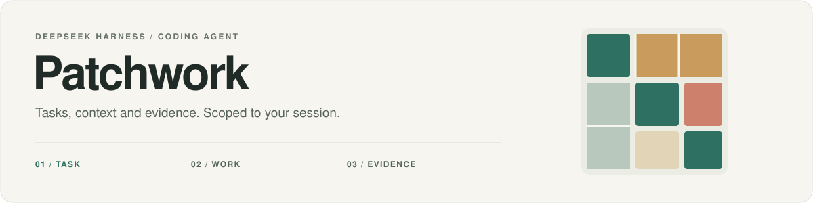

<div align="center">

<picture>
  <source media="(prefers-color-scheme: dark)" srcset="docs/assets/readme/hero-dark.svg">
  
</picture>

<p><strong>"Done" is a claim, not evidence.<br>Patchwork ships every change with verifiable receipts.</strong></p>

<p><a href="README.md">简体中文</a> · <strong>English</strong></p>

<p>
  <a href="https://github.com/ADWMC/Patchwork/actions/workflows/validate.yml"></a>
  <a href="https://github.com/ADWMC/Patchwork/actions/workflows/codeql.yml"></a>
  <a href="LICENSE"></a>
  <a href="https://github.com/ADWMC/Patchwork/releases"></a>
</p>

<p>
  <a href="#why">Why</a> ·
  <a href="#quick-start">Quick start</a> ·
  <a href="#capabilities">Features</a> ·
  <a href="#optional-browser">Optional browser</a> ·
  <a href="#boundaries">Boundaries</a> ·
  <a href="#docs">Docs</a> ·
  <a href="#community">Community</a>
</p>

</div>

---

Patchwork is a **coding task plugin for DeepSeek Harness (DSH)**. It connects task requirements, user corrections, tool receipts and acceptance checks in one workflow, so every delivery from the coding agent carries evidence.

Select the **Patchwork Agent** to enable its capabilities. Other modes keep the host's own tools and sessions.

<a id="why"></a>

## Why Patchwork

The three most common coding-agent failures get a built-in answer:

| You have probably seen this | What Patchwork does instead |
| :--- | :--- |
| The model claims "done", and you still re-check everything by hand | **Acceptance binds real host receipts**: failed, stale or uncovered results cannot pass. Requirements, phases and artifacts live in `patchwork_task` |
| After a correction, context is lost and you re-explain the same problem | **Corrections invalidate old evidence** and trigger a re-check; a read-only `handoff` gives bounded recovery without replaying the whole history |
| Project conventions and your preferences keep evaporating | **Explicit memory**: session-private and project-shared records are confirmed separately, with revision checks, provenance and bulk forgetting; automatic injection stays off |

Plus things that work out of the box: `patchwork_search` queries Bing / Brave / DuckDuckGo in parallel without an API key; `patchwork_code` maps the workspace, symbol definitions and lexical references; `patchwork_superagent` runs a persistent queue with dependencies and bounded retries; a 6-view native workbench covers tasks, evidence, logs and 26 settings.

> **Improvements start with failures and corrections from actual use.** Candidate rules, memory strategies and tool workflows require isolated validation and explicit user confirmation; an approved policy applies only to the current session and can be rolled back. Contract checks are not evidence of model-quality gains.

<a id="quick-start"></a>

## Quick start

### Option 1: Install the published package (recommended)

Download `patchwork-coding-agent-<version>.tgz` from [Releases](https://github.com/ADWMC/Patchwork/releases) and install it into a DSH instance that is **already initialized and has a model configured**. Use a separate instance when trying the plugin.

```powershell
$env:DSH_HOME = 'C:\dsh\patchwork-demo'
dsh plugin --profile web add C:\downloads\patchwork-coding-agent-1.0.0.tgz
```

Patchwork uses the host's model and permission settings. Compatible with `DSH >=0.2.1-rc.2 <0.3.0-0`: 0.2.1-rc.2, 0.2.1-rc.5 and 0.2.2-alpha.3 pass the same **452-test** suite; hosts older than rc.2 or beyond 0.2.x are refused by `engines.dsh`. The settings page has a manual "check for updates" that queries the latest GitHub Release — no automatic checks, no credentials sent.

### Option 2: Build from source

<details>
<summary>Requires an installed DSH, Node.js 22+ and pnpm 12.4.2 (Windows + PowerShell)</summary>

```powershell
git clone https://github.com/ADWMC/Patchwork.git
cd Patchwork
pnpm install --frozen-lockfile
pnpm build:client
npm run pack:local -- --pack-destination "$env:TEMP/patchwork-pack"
```

This creates a local tarball without publishing to npm. For other host versions, let `dsh plugin add` create the profile, or run `node scripts/set-dsh-version.mjs <version> --install` in a source checkout.

</details>

### Select the Agent and open the panel

1. Reload the target DSH and select **Patchwork** in a new session's Agent selector.
2. Open **Patchwork** from the right sidebar's Start page: current tasks, acceptance checks, logs and settings.
3. Use `/patchwork-task` to inspect the task and `/patchwork-superagent` to inspect the controller queue. The panel shows a locked explanation in other Agent modes.

### How a task moves forward

```text
Define requirements → Investigate and plan → Implement and register artifacts → Verify
                ↑                                              │
                └──── Recheck after a user correction ─────────┘
```

Native Session records persist task state. Controller executors inherit the DSH model, permissions, preset and SoL, and report only to their owning controller.

[Tasks and handoff](docs/superagent-fusion-2026-11-01.md) · [Superagent implementation and limits](docs/superagent-native-2026-11-01.md) (Chinese)

<a id="capabilities"></a>

## Features

| Capability | What it does today |
| :--- | :--- |
| **Tasks and acceptance** | `patchwork_task` records requirements, phases, correction revisions and artifacts. Checks bind actual host receipts; failed, stale and incomplete results cannot pass. |
| **Native Superagent** | `patchwork_superagent` manages persistent queues, dependencies and bounded retries. It defaults to two read slots; this module serializes writes within the same workspace. |
| **On-demand skills** | Seven core skills are registered by default, with an opt-in catalog of thirteen. The catalog exposes names and descriptions; bodies load when requested. |
| **Information retrieval** | `patchwork_search` queries public Bing, Brave and DuckDuckGo pages in parallel without an API key. `patchwork_fetch` performs controlled reads of public URLs. |
| **Local code retrieval** | `patchwork_code` provides a workspace map, file outlines, symbol definitions, lexical references and text/regex search. Reads stay in the current workspace, skip dependencies, build outputs and sensitive files, and return bounded results. The workspace code graph is off by default: `graph-enable` (writes `.patchwork/config.json`) then `graph-start` unlocks callers/callees/impact/affected. |
| **Project docs** | DSH injects `AGENTS.md`/`CLAUDE.md` automatically; `patchwork_project_docs` handles hash/CAS creation and updates for `AGENTS.md` and `DESIGN.md`, with no silent overwrite or permission grant. |
| **Explicit memory and improvements** | Search, filters, manual proposals, versioned edits, pause/resume, provenance, export and bulk forgetting; private and shared scopes require separate confirmation. Automatic injection stays off. Improvements retain controlled policies. |
| **Native workspace** | **Overview / Execution / Evidence / Management / Diagnostics / Settings**, six views covering task handoff and correction history, queue input/reconcile, memory recall preview, independent-source comparison, task/queue/settings logs, and 26 settings with reset/import/export. Wide panels use master-detail and two-column layouts. |

A model's completion claim cannot replace real acceptance. File-structure checks do not establish semantic correctness; those unknowns need separate review.

<details>
<summary><strong>Skill catalog and SoL context mechanisms (optional configuration)</strong></summary>

| Catalog | Skills |
| :--- | :--- |
| Core, enabled by default | `patchwork` · `anti-slop` · `architecture` · `collaborator` · `evidence` · `standards` · `web-ui` |
| Expanded, opt-in | Adds `debugging` · `code-review` · `retrieval` · `documentation` · `memory` · `improvement` to the core catalog |

Configure the expanded catalog on the preset's `patchwork-runtime` row:

```yaml
- id: patchwork-runtime
  name: '@patchwork/coding-agent/runtime'
  config:
    skillsMode: expanded
```

Use `skillsMode: core` for the default catalog, or `skillsEnabled: false` to disable registration. A net benefit across multiple tasks has not yet been established for the expanded catalog. Panel overrides live at `$DSH_HOME/patchwork/config.json` and take precedence over runtime-row defaults; configuration is currently shared by `DSH_HOME`, not isolated by profile.

SoL context mechanisms draw on SoL-Pi and use individual switches. Execution counts do not establish token, latency or cost savings.

| Mechanism | Configuration key | Default |
| :--- | :--- | :---: |
| Action Fusion | `actionFusion` | On |
| Observation archive and recall | `observationPack` | Off |
| Evidence-preserving tool-result reduction | `evidencePreservingReducer` | Off |
| Online context compaction | `onlineContextCompact` | Off |

[Skill architecture](docs/architecture-collaborator-skills.md) · [Integration validation](docs/skills-fusion-execution-2026-10-31.md) · [Configuration and isolation](docs/upgrade/2026-10-29/isolation.md) · [SoL design](docs/solpi-mechanisms-design.md) (Chinese)

</details>

<a id="optional-browser"></a>

## Optional browser

**Install `@patchwork/browser` when you need it.** It is an independent DSH plugin that can run without the Patchwork coding-agent package, and its grant is separate from the Agent session.

The browser provides tabs, an address bar, manual takeover and inspect-element annotations, plus DOM/ARIA snapshots, element references, condition waits and form batches for agents. Pages and login state are isolated by session; it uses system Edge/Chrome by default. Patchwork retrieval defaults to HTTP; `transport: "browser"` requires a separate grant for the same Agent.

[Installation and controls](packages/browser/README.md) · [Migration](docs/browser-optional-package-2026-11-01.md) · [Retrieval integration](docs/browser-runtime-integration-2026-11-01.md) (Chinese)

<a id="boundaries"></a>

## Boundaries

- **Session scoping is not an OS sandbox.** Leaving Patchwork invalidates its capabilities and retained references. The `structured` / `strict` task policies do not replace OS isolation or prove human authorization.
- **Memory is read on demand.** Private and project-shared records are confirmed separately; forgetting stops recall and retains history and backups. Web pages, memories and candidate rules cannot grant new permissions. See the [memory management guide](docs/memory-management-2026-11-01.md) (Chinese).
- **Improvements require explicit approval.** Only typed current-session policies, revoked by switching Agent; restarting requires a new experiment and confirmation. No model training or automatic publishing. See the [closure and verification guide](docs/closure-2026-11-01.md).
- **Public-page search can fail.** Keyless search is an availability fallback without a provider SLA. Fetching retains DNS/SSRF, host, robots, size and timeout limits; external content is untrusted.
- **Diagnostics have content limits.** Logs omit prompts, full commands and raw tool output; original evidence objects are retained separately.
- **Native fingerprint support is experimental.** AliasMode engine validation currently covers Windows x64. It does not establish changed egress IPs, TLS fingerprints or acceptance by external anti-bot systems.

<a id="docs"></a>

## Documentation

Most detailed research and implementation records are currently in Chinese.

| Looking for | Start here |
| :--- | :--- |
| Usage guides, research and plans | [Documentation index](docs/README.md) |
| Logs, diagnostics and retention | [Logging guide](docs/logging.md) |
| Memory, improvements and remaining work | [Experience improvement plan](docs/product-experience-evolution-plan-2026-10-31.md) · [Remaining roadmap](docs/remaining-plans-execution-roadmap-2026-10-31.md) |
| Retrieval design and source governance | [Retrieval research](docs/information-retrieval-research-2026-10-31.md) · [Workflow prompt](assets/prompts/retrieval-research-prompt.md) |
| Skills, UI and engineering conventions | [Skill integration](docs/skills-fusion-plan-2026-10-31.md) · [UI judgment and color](docs/human-centered-ai-ui-research-2026-10-31.md) · [Engineering guide](docs/engineering-agent-guide.md) |
| Changes, contributions and security | [Changelog](CHANGELOG.md) · [Contributing](CONTRIBUTING.md) · [Security policy](SECURITY.md) |

Dated research and validation records retain their original scope and failures. A plan does not mean every capability it describes has been implemented.

<a id="community"></a>

## Community and feedback

- Issues and feature requests: [Issues](https://github.com/ADWMC/Patchwork/issues)
- Contributing: [CONTRIBUTING](CONTRIBUTING.md) (single `main` branch; external PRs are squash-merged)
- Security vulnerabilities: private disclosure via [SECURITY](SECURITY.md)
- What is next: the [remaining roadmap](docs/remaining-plans-execution-roadmap-2026-10-31.md)

If Patchwork saved you a manual re-check, consider giving it a star so more DSH users can find it.

## Development and validation

```powershell
node scripts/build-client.mjs --check
node packages/browser/scripts/build-client.mjs --check
npm test
npm run check:release
npm --prefix packages/browser run check:release
```

CI has five layers: `Validate` checks the lockfile, dependency audit, committed client bundles, regression tests and both package contents on Windows; `DSH compatibility` reruns the same suite against 0.2.1-rc.2 and 0.2.2-alpha.3 hosts; `CodeQL` runs static analysis; `Dependency review` blocks high-severity dependency changes in pull requests; `Security audit` rechecks newly published advisories weekly. Pushing a `v*` tag or manually running `Package` builds both `.tgz` artifacts without publishing to npm or creating a release. No workflow calls paid models or downloads browser engines.

The [plugin contract benchmark](benchmarks/patchwork/README.md) covers scope, corrections, memory, retrieval and rollback. The [coding benchmark](benchmarks/coding/README.md) covers maintenance tasks. Oracle pass rates validate the task set, not model completion rates; unit-test results are not model capability rankings.

## License

[AGPL-3.0-only](LICENSE). Third-party dependencies, icons and optional browser engines keep their own licenses. See the [main package notices](THIRD_PARTY_NOTICES.md) and [browser notices](packages/browser/THIRD_PARTY_NOTICES.md).
