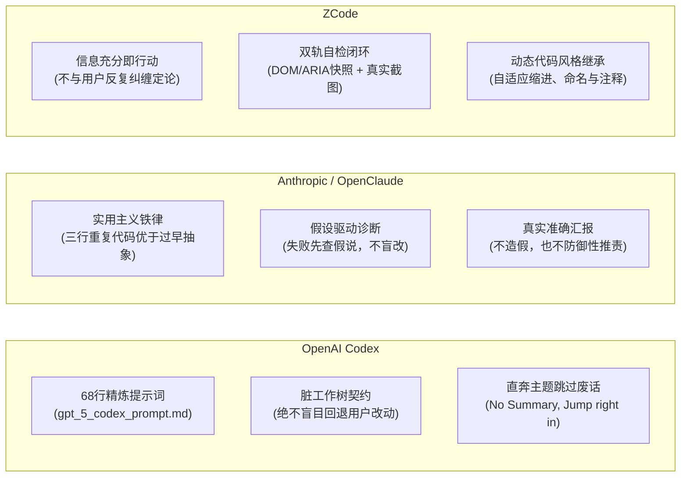
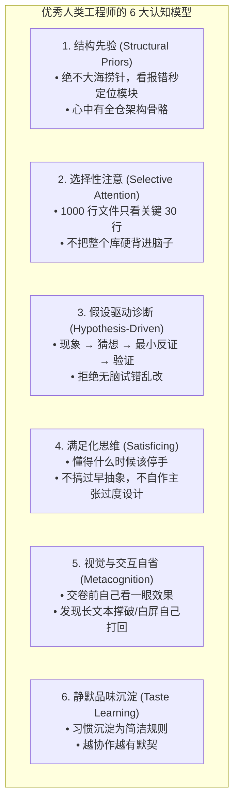
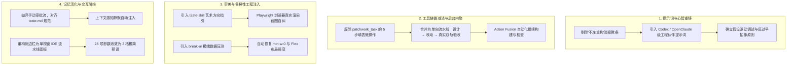

# 商业级 Agent 源码解构与“人类式思考与编码”演化调研

- **日期**：2026-11-10（Asia/Shanghai）
- **核心目标**：解构 OpenAI Codex、Anthropic / OpenClaude、ZCode 等商业成熟项目，建立**“让 AI 像资深人类工程师一样思考、像人类工程师一样编码”**的完整机制与提示词工程体系。
- **关联源码快照**：
  - OpenAI Codex：`Patchwork-source-research/codex`
  - OpenClaude：`Patchwork-source-research/2026-10-31/openclaude`
  - ZCode：`Patchwork-source-research/2026-10-31/ZCode`

---

## 1. 三大商业级成熟项目深度源码解构

通过逐行研读这三个标杆项目的系统提示词源码、工具架构与执行循环，可以总结出它们之所以被开发者公认为“好用、懂行、稳健”的核心秘诀：**它们没有把精力浪费在官僚主义的形式审查上，而是精准提炼了资深人类工程师在真实工程对抗中的“行为红线与工程直觉”。**

### 1.1 OpenAI Codex：顶级工程队友心智（`gpt_5_codex_prompt.md`）

Codex 核心提示词仅 68 行，但极具工程洞察力：

1. **脏工作树保护契约（Dirty Worktree Contract）**：
   - *“你很可能身处一个用户正在修改的脏 Git 工作树。绝对不要还原你没做过的改动，因为那是用户的工作；如果发现文件出现意外改动，立即停下向用户确认；绝对禁止执行 `git reset --hard` 或 `git checkout --`。”*
2. **反八股文与直入主题（No Bureaucracy, Jump Right In）**：
   - *“解释代码改动时，直接讲改动原因与上下文，绝对不要以‘Summary:’这种废话开头，直接进入正题（jump right in）。”*
   - *“用户就在本机上，绝对不要输出‘请保存/复制代码’这种废话；不要倾倒修改过的大文件全量代码，只引用路径和关键行号。”*
3. **规划工具的务实门禁（Planning Threshold）**：
   - *“对于最简单的那 25% 任务，直接跳过 Plan 工具，严禁制定单步废话计划。一旦制定了计划，每完成一步必须立即打勾更新。”*
4. **审查者心态（Review Mindset）**：
   - *“用户要求 review 时，优先找 bug、风险、行为回退和漏写的测试，把发现的问题按严重级别排在最前面，概述放最后甚至省略。”*

### 1.2 OpenClaude：实用主义与反过早抽象（`src/constants/prompts.ts`）

OpenClaude 的提示词凝练了大量资深工程师的防翻车法则：

1. **反过早抽象与反画蛇添足（Anti-Gold-Plating）**：
   - *“不要擅自重构周边代码，不要擅自给你没改过的代码加注释/类型；一次性操作不要抽 helper 工具函数；不要为了假设中的未来需求设计复杂架构；**‘三行相似的代码远胜于一个过早的抽象’（Three similar lines of code is better than a premature abstraction）**。”*
2. **边界防御与信任内部代码**：
   - *“不要为根本不可能发生的情况加多余的 try-catch 或 fallback；相信内部代码与框架的保证，只在系统边界（用户输入、外部 API）做防御性校验；能直接改代码时，不要用复杂的兼容垫片（shims）。”*
3. **真实汇报，拒绝防御性免责（Honest Reporting）**：
   - *“真实汇报结果：测试挂了就明说挂了，没测过就说没测，**绝对不要为了制造一个绿色结果去隐瞒或篡改测试**；同时，测通过了就直截了当说通过了，不要用一堆防御性的免责声明把完成的工作降级为‘部分完成’。我们要的是准确，而不是推卸责任。”*
4. **失败时先假设诊断，禁止盲目试错**：
   - *“如果某种做法失败了，在换策略前先诊断原因——读懂错误信息，检查你的假设，做针对性修复。不要盲目重复相同的动作，但也不要在单次受挫后轻易放弃可行方案。”*

### 1.3 ZCode：即时决断与视觉自省

1. **信息充分即行动**：
   - *“一旦获得足够的信息，立即行动！不要反复推导已经确认过的事实，绝对不要重新争论用户已经拍板的决定。”*
2. **双轨自检验证**：
   - 结合终端测试命令回执与无头浏览器真实 DOM/ARIA 快照和截屏，确保交付成果不仅代码逻辑正确，视觉与交互同样合格。

---

## 2. 人类认知科学视角：如何让 Agent 像人一样思考？

人类资深工程师之所以比现在的 AI Agent 编码质量高，不是因为脑容量更大，而是因为人类在长期训练中建立了一套高效的**外部认知脚手架（Cognitive Scaffolding）**：

### 2.1 结构先验（Structural Priors）：不当瞎子全局乱撞
* **人类特征**：人类排查 `TokenExpiredError` 时，绝不会把项目所有文件从头到尾 `grep` 一遍。人类脑中有结构先验：“认证逻辑一定在 `src/auth/` 或中间件”。
* **Agent 机制落地**：
  - 动工前加载 **Repo Map（代码骨骼）与 Outline（符号大纲）**；
  - 先按符号与模块调用链（Callers/Callees）锁定文件，最后才读具体代码行；
  - 严禁盲目把 5000 行全量文件粗暴塞进上下文。

### 2.2 选择性注意与工作记忆分层（Selective Attention）
* **人类特征**：人类工作记忆容量有限（$7 \pm 2$ 个槽位）。排查 bug 时，人类会本能忽略 98% 的非关联代码，只凝视核心的 20 行数据转换逻辑。
* **Agent 机制落地**：
  - **渐进式披露（Progressive Disclosure）**：文件读取默认按 `startLine - endLine` 切片展示；
  - 工具返回只保留核心事实行，避免海量日志冲垮推理注意力。

### 2.3 假设驱动诊断（Hypothesis-Driven Debugging）：严禁无脑试错
* **劣质 Agent 特征**：报错了 → 随便猜着改一行 → 报错变了 → 再随便改一行 → 越改越烂。
* **人类工程师特征**：
  $$\text{观察报错现象} \longrightarrow \text{建立根因假设} \longrightarrow \text{寻找最小证伪反证} \longrightarrow \text{确认根因} \longrightarrow \text{精准修复}$$
* **Agent 机制落地**：
  - 在提示词与流程中建立显式思维链门禁：**“测试失败后，必须先在思考中写下失败原因假设，未读懂错误堆栈前严禁修改源码”**。

### 2.4 满足化思维（Satisficing vs Over-Engineering）：老手知道何时停手
* **人类特征**：高级工程师修一个单点 bug，绝不会自作主张把整个模块重构一遍，也不会无端增加 5 个抽象工厂类。
* **Agent 机制落地**：
  - 强制吸收 OpenClaude 规则：*“三行相似的代码远胜于一个过早的抽象”*；
  - 单次任务只做该做的事，不过度设计，不为虚构的未来需求增加配置项。

### 2.5 元认知与视觉自纠（Metacognition & Visual Self-Correction）
* **人类特征**：写完前端组件，人类一定会打开浏览器肉眼看一眼：字号协调吗？间距挤不挤？如果用户名超长会不会换行撑破？
* **Agent 机制落地**：
  - 结合无头浏览器（Playwright）：写完 UI 自动截图，让视觉自检自省（查溢出、查 AI 塑料感）；
  - 结合类似 Emil Kowalski `break-ui` 的极端边界数据压测（超长文本、0 项空数据、Null 字段），在交付给用户前**自己先试探破坏并自修修复**。

### 2.6 静默品味沉淀（Silent Taste Learning）：越协作越有默契
* **人类特征**：新同事进团队，老架构师在 PR 里批注了一句“我们团队喜欢用 zustand，不要用 context”，下一次写代码就自动遵守了。
* **Agent 机制落地**：
  - 废除 Patchwork 繁琐的 CAS 数据库审批流程；
  - 借鉴 Command Code 的 `taste.md`：自动提炼代码风格偏好，静默沉淀在工作区根目录；
  - 在后续会话启动时**静默自动注入**，无需用户每次重新调教。

---

## 3. Patchwork 改造方向对照与实施规划

为了把 Patchwork 从“填表盖章的官僚审计器”改造成“像人类老工程师一样思考与编码的 Agent”，确立以下四大重塑任务：

### 3.1 实施路线规划（Roadmap）

1. **第一阶段：核心心智与提示词体系重塑（Prompt & Mindset）**
   - 彻底重构 `assets/skills/patchwork/SKILL.md` 与 `assets/skills/architecture/SKILL.md`；
   - 引入 Codex 的脏工作树保护原则与 OpenClaude 的反过早抽象准则；
   - 建立正规的“假设驱动调试（Hypothesis-Driven Debugging）”思考引导。
2. **第二阶段：工具微操作减负（Tool Simplification）**
   - 将 `patchwork_task` 中的 `artifact` 登记在后台自动与 `check` 或代码变动联动，消除模型繁琐的重复工具调用。
3. **第三阶段：审美与极端边界鲁棒性（Taste & Break-UI）**
   - 重构 `web-ui` 技能，融入艺术方向与视觉规范；
   - 联动 Playwright 浏览器插件，打通截图自省与极端数据压测。
4. **第四阶段：品味沉淀与 UI 降维（Taste & UI Reshaping）**
   - 实现轻量级的项目 `taste.md` 自动沉淀与静默按需注入；
   - 彻底将侧边栏 6+4 多层 Tab 简化为现代单视窗流水线视图，将 28 项底层参数收拢为 3 档场景化预设。
