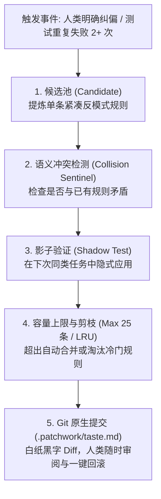

# Patchwork 2.0 工匠架构与工具协同总方案 (Patchwork Craftsman Master Plan)

> 日期：2026-11-10  
> 状态：设计完成 / 待实施  
> 定位：Patchwork 从“学术机制堆叠”蜕变为“具备资深工匠心智与双轨真实验收的代码助手”的总体架构规范。

---

## 目录

1. [现状诊断：为什么 Patchwork 显得太杂太累？](#一现状诊断为什么-patchwork-显得太杂太累)
2. [顶层设计哲学：奥卡姆剃刀与三大收敛原则](#二顶层设计哲学奥卡姆剃刀与三大收敛原则)
3. [核心概念定义：到底什么是 taste.md？](#三核心概念定义到底什么是-tastemd)
4. [自主进化的确定性保障：五重稳定性护栏](#四自主进化的确定性保障五重稳定性护栏)
5. [原创命名体系与功能全景图](#五原创命名体系与功能全景图)
6. [现有 7 大底层重型工具的端到端编排与协同机制](#六现有-7-大底层重型工具的端到端编排与协同机制)
7. [代码级映射与文件改动清单](#七代码级映射与文件改动清单)
8. [极简交互体验：单屏工匠流水线看板](#八极简交互体验单屏工匠流水线看板)

---

## 一、现状诊断：为什么 Patchwork 显得太杂太累？

经过对 Patchwork 现有代码（511 项单元测试、`src/` 核心模块、`packages/browser`）的全面审计，当前系统的根本瓶颈不在于能力欠缺，而在于**机制碎片化、流程官僚化和认知载荷严重倒挂**：

### 1. 机制碎片化 (Feature Bloat)
- 暴露了 **28 个底层学术参数**（如 `cacheWriteReadRatio: 12.5`、`superagentStallMs: 600000`、`reducerMaxTokens: 2048`），将中间层超参数抛给开发者，缺乏高层开箱即用模式。
- 侧边栏堆砌了 **6 个一级 Tab + 4 个二级 Tab（共 11 个独立视图）**，信息割裂，用户难以追踪一条主线。

### 2. 流程官僚化 (Process Friction)
- `patchwork_task` 强加了 10 个琐碎 Action：`inspect` → `define` → 编辑 → `artifact`（逐个文件登记路径和哈希）→ `check`。
- 如果在中间执行了任何一次排查用的 `shell` 命令，所有已登记的 `artifact` 会被立即置为 `invalid`，导致抛错中断，AI 被迫陷入死循环。

### 3. 认知载荷倒挂 (Cognitive Inversion)
- 在 `agent/pre-step` 中，系统每次向模型注入高达 8000 字符的死板 JSON：`[pw:handoff] {"schemaVersion":1,"taskId":...}`。
- **AI 每次思考，有 70% 的上下文和算力耗费在配合 Patchwork 的管理协议填表，只有 30% 在真正理解业务逻辑和编写高质量代码**。

### 4. 记忆与经验成了“死库” (Zombie Vaults)
- `src/memory/tool.mjs` 设置了 `automaticInjection: 'disabled'`，要求记忆必须在 UI 上由人工点击批准，且必须由模型主动猜 query 发起 `recall`。
- `src/improvement/`（改进候选集）和 `src/structure/`（捷径治理）各自为政，无法形成合力。

---

## 二、顶层设计哲学：奥卡姆剃刀与三大收敛原则

我们确立 Patchwork 2.0 的核心公式：
$$\text{高质量交付} = \text{极简心智模型 (3步环)} + \text{活的工程契约 (.patchwork/taste.md)} + \text{零摩擦执行链路 (能力下沉)}$$

### 三大收敛原则：
1. **能力全面下沉，严禁暴力删除**：
   已有的 7 大重型底层资产（Playwright 浏览器、代码索引、无密钥检索、证据约简、文件锁安全数据库、主控调度、安全沙箱）**100% 保留**，从“暴露在外的繁琐零件”下沉为“自动化引擎”。
2. **流程天然自洽，消除人造表单**：
   废除人工打卡登记。AI 只需要专注于代码实现，文件感知、哈希校验、测试回执由系统后台自动完成。
3. **经验透明受控，拒绝黑盒玄学**：
   记忆与反思不再藏在闭门数据库里，全部收敛为项目根目录中受 Git 版本控制的 Markdown 文件。

---

## 三、核心概念定义：到底什么是 taste.md？

在我们的系统架构中，`taste.md` 绝不是玄学概念，而是**「项目工程与美学契约 (Craftsmanship & Aesthetic Contract)」**。

### 1. 本质定位
它是项目团队高级工程师/架构师代码洁癖的白纸黑字固化，用于**阻断 AI 的代码塑料味（过度抽象、深层嵌套、废话注释、廉价 UI 渐变、掩盖 Bug 的空特判）**。

### 2. 四维标准契约规范

文件默认位于项目根目录 `.patchwork/taste.md`：

```markdown
# 项目工程品味契约 (.patchwork/taste.md)

## 1. 架构品味 (Architectural Invariants)
- 单一事实源 (SSOT)：状态只在一处持有，派生状态使用计算属性派生，严禁在多处手动维护同步副本。
- 三行重复优于过早抽象：在同一模式出现三次且具备相同变更动因前，严禁引入高阶泛化封装或工厂模式。
- 目录与依赖拓扑：纯工具函数收敛于 util/，有副作用与网络 IO 收敛于 bridge/，严禁跨层循环依赖。

## 2. 实现品味 (Implementation Taste)
- 卫语句扁平化：优先使用卫语句提前 return，主干逻辑保持零缩进层级，严禁 3 层以上 if-else 嵌套。
- 快速失败不吞错：预期异常显式定义错误码，未知异常抛出并保留堆栈，严禁空的 catch {} 块。
- 零废话注释：命名即文档；注释仅用于解释“为什么这么做 (Why)”，绝不解释“这一行干了什么 (What)”。

## 3. 视觉与交互品味 (Visual & Interaction Taste)
- 抵御 AI 塑料感：严禁通用紫色渐变、过大外发光阴影与生硬的弹跳骨架屏。
- 严格空间节奏：间距与内边距严格遵守 4px / 8px 栅格节奏，基准字阶 14px，优先使用系统原生字体栈。
- 触感交互回执：可交互元素必须具备即时反馈（40ms 激活态高亮与悬浮态过渡），严禁无视觉回执的静默等待。

## 4. 禁手清单 (Banned Anti-patterns / Negative Taste)
- 【绝对禁手】严禁为了让测试通过而弱化、注释或删除现有的断言 (assert)。
- 【绝对禁手】严禁在未度量真实性能瓶颈前引入私有缓存层或 Memoization。
- 【绝对禁手】严禁在缺少实际调用点的情况下预先编写“工具类 / Helper”。
```

### 3. 机器层面的两阶段运作机理
- **生成期 (Generation)**：`TasteEngine` 解析 Markdown，根据当前受影响文件类型（`.jsx` 匹配视觉契约，`.mjs` 匹配架构契约），抽取最核心的 3~5 条规则（< 500 tokens）静默注入上下文。
- **验收期 (Verification)**：在 `check` 执行时，通过 AST 比对与浏览器渲染核验，只要触发【禁手清单】，立即驳回重写。

---

## 四、自主进化的确定性保障：五重稳定性护栏

为了解决“AI 自主进化导致越学越偏、规则打架、规则膨胀”的致命缺陷，系统建立了**五重确定性工程护栏**：



1. **双层宪法架构（分级不可变性）**：
   - **Level 0 核心宪法（只读）**：安全沙箱、禁止删测试断言、禁止吞异常。写死在系统底层源码，AI 无论如何自省进化都无权修改。
   - **Level 1 项目品味（受控进化）**：代码风格、组件约定、特定业务坑点。
2. **证据门禁（不见棺材不落泪）**：
   严禁凭空生成规则；必须由人类明确纠偏语句或真实的构建/测试失败触发。
3. **候选缓冲期（Candidate → Active）**：
   新提炼的经验暂存候选池，必须通过与已有规则的语义冲突检查，并在下一次同类任务中验证有效后，方可转正。
4. **容量上限与奥卡姆剪枝**：
   全篇硬性限制不超过 **25 条规则（约 800 tokens）**。当新规则加入导致超限时，强制触发同类语义合并或淘汰连续 30 次未命中的冷门规则。
5. **Git 原生追踪与秒级回滚**：
   进化成果是白纸黑字的 Git 提交，`git checkout .patchwork/taste.md` 可随时恢复出厂设置。

---

## 五、原创命名体系与功能全景图

我们彻底摆脱 Command Code 的营销包装，建立纯粹属于我们自己的工匠词汇体系：

| 第三方概念 | 我们的原创命名 | 体系内定位 |
|---|---|---|
| Taste 包 / Mods | **「工程范式 (Archetypes)」** | 针对特定技术栈（C++、React、Go微服务）的开箱即用品味模板。 |
| Agent Skills (break-ui) | **「专项工匠手记 (Craft Directives)」** | 内置在流程中的高级指导（如：代码卫语句重构手记、界面间距核对手记）。 |
| Playwright Inspector | **「视觉检验刃 (Visual Blade)」** | 内置无头浏览器真实视口截屏与样式比对引擎。 |
| Mod Hub | **「范式工坊 (Craft Atelier)」** | 社区共享与私有团队规范分发中心。 |

### Patchwork 2.0 最终具备的四大功能矩阵：

```
┌────────────────────────────────────────────────────────────────────────┐
│                   Patchwork 2.0 四大核心能力矩阵                       │
├──────────────────┬──────────────────┬──────────────────┬───────────────┤
│ 1. 认知与编码    │ 2. 双轨真实验收  │ 3. 自主经验进化  │ 4. 极简人机交互│
│                  │                  │                  │               │
│ • 范式自适应加载 │ • 代码测试物理轨 │ • 真实教训自动提炼│ • 单屏工匠流水│
│ • 卫语句优雅重构 │ • 浏览器视口视觉轨│ • 双层不可变宪法 │   线看板      │
│ • 假设驱动查根因 │ • 禁手红线实时拦截│ • Git透明一键回滚│ • 双模一键切换│
└──────────────────┴──────────────────┴──────────────────┴───────────────┘
```

---

## 六、现有 7 大底层重型工具的端到端编排与协同机制

这 7 大底层模块不仅全部保留，而且在**三步工匠环 (Orient → Act → Verify)** 中全面发挥合力：

### 阶段一：智能定向 (Orient Stage)
- **触发源**：`ctx.on('agent/inbox/inserted')` 接收到用户开发指令。
- **代码拓扑探测 (`src/code/`)**：
  静默调用 `CodeIndex.find` 与 `outline`，根据任务关键词在 0.1 秒内锁定最相关的 3 个源文件和核心入口符号，形成代码事实锚点。
- **品味契约切片 (`src/taste/engine.mjs` + `src/memory/store.mjs`)**：
  利用 `src/memory/store.mjs` 的高可靠文件锁与哈希机制安全读取 `.patchwork/taste.md`，根据受影响文件扩展名筛选出对应的 3~5 条规则。
- **外部知识预加载 (`src/retrieval/`)**：
  若检测到未知前沿库或错误码，`src/retrieval/public-search.mjs` 与 `public-fetch.mjs` 在后台无密钥并发检索，拉取权威示例。
- **组装装配**：在 `agent/pre-step` 中向模型输出小于 400 tokens 的极简工匠认知上下文：
  `[Craftsman Objective]` + `[Code Anchors]` + `[Active Taste Invariants]`。

### 阶段二：零摩擦敏捷实施 (Act Stage)
- **模型自由编码**：执行代码读取、符号跳转与修改，无任何审批中断。
- **大输出静默约简 (`src/mechanisms/`)**：
  - `observation-pack`：自动捕获大文件的冗长输出并保存在磁盘。
  - `evidence-preserving-reducer`：当构建或测试产生数千行日志时，自动提炼为最核心的 20 行报错堆栈，彻底保护模型的上下文窗口。
- **沙箱安全哨兵 (`src/task/action-check.mjs`)**：
  在底层静默拦截越界写入与恶意路径逃逸。

### 阶段三：双轨自愈验收 (Verify Stage)
- **触发**：AI 仅需执行单次验证命令（`patchwork_task check`）。
- **自愈式目标捕获 (`src/task/acceptance.mjs`)**：
  彻底废除手动的 `artifact` 登记动作。系统自动根据 Git 变更感知修改的文件，自动计算 `stat` 与哈希 stamp，完成自愈登记。
- **第一轨：代码与构建物理轨**：
  执行宿主环境真实测试命令，捕获原始 `exitCode` 与结构化回执。
- **第二轨：视口与交互视觉轨 (`packages/browser/`)**：
  检测到修改涉及前端代码时，自动调用 `packages/browser/src/browser/tool.mjs` 启动后台无头浏览器，加载本地服务，截取视口真实截图并检查 DOM 计算样式。
- **禁手哨兵核验**：
  AST 比对检查 AI 是否修改/删除了已有测试断言，若违规直接判定不合格并要求回滚。

### 阶段四：经验沉淀与自省闭环 (Reflect Stage)
- **教训提炼 (`src/improvement/` + `src/memory/`)**：
  多次重试后解决的问题，由 `src/improvement/` 的状态机提炼为反模式禁令，通过 `src/memory/store.mjs` 安全追加至 `.patchwork/taste.md` 候选区。
- **长任务兜底 (`src/superagent/`)**：
  大型跨模块任务若出现进展停滞，`superagent` 的停滞检测器自动唤醒并调度子智能体协助。

---

## 七、代码级映射与文件改动清单

| 现有文件 | 角色变化 | 具体改动点 |
|---|---|---|
| `src/runtime.mjs` | 架构总装线 | 实例化 `TasteEngine`，将其注册为全局服务，注入 `registerTaskLifecycle`。 |
| `src/task/lifecycle.mjs` | 任务调度中枢 | 改造 `agent/pre-step`：废除 8000 字符的 `[pw:handoff]` JSON，替换为紧凑的工匠认知上下文。 |
| `src/task/acceptance.mjs` | 验收执行器 | 改造 `capture()`：引入自动目标捕获与哈希自愈逻辑，支持单步直接 check。 |
| `src/task/handoff.mjs` | 状态快照 | 瘦身精简：只保留核心任务目标与当前假设，移除冗长管理元数据。 |
| `src/taste/engine.mjs` | **[新建模块]** | 解析 `.patchwork/taste.md`，负责自适应切片、冲突检测与 LRU 剪枝。 |
| `assets/skills/patchwork/SKILL.md` | 主技能提示词 | 重写：废除“不做重构、保留既有模式”的保守枷锁，植入四步工匠心智法则。 |
| `src/client/WorkspacePanels.jsx` | 客户端工作台 | 将 11 个分散 Tab 折叠收拢为单屏幕三段式「工匠流水线看板」。 |
| `src/config/fields.mjs` | 系统配置 | 将 28 个零散微观参数封装为 2 个高阶预设：`Craftsman (工匠模式)` 与 `Explore (探索模式)`。 |

---

## 八、极简交互体验：单屏工匠流水线看板

侧边栏 UI 全面革新，彻底摒弃碎裂的抽屉式 Tab，统一为一屏三段式的流水线看板：

```
┌────────────────────────────────────────────────────────────────────────┐
│  Patchwork Craftsman Studio (工匠工作台)                       [模式: 敏捷] │
├─────────────────┬───────────────────────────────┬──────────────────────┤
│ 1. 契约与目标    │ 2. 实施过程与 Diff             │ 3. 双轨真实验收      │
│                 │                               │                      │
│ • 当前任务目标   │ • 正在验证的假设              │ • 自动化测试: PASS   │
│ • 本次生效的    │ • 受影响文件 (3 个)           │   (511 tests passed) │
│   Taste 规则:   │ • 变更 Diff 预览              │ • 视觉截图回执:      │
│   - SSOT原则    │                               │   [页面真实截图缩略] │
│   - 扁平卫语句  │                               │ • 违背禁手检测: 0 处 │
│                 │                               │                      │
│ [编辑契约]      │ [一键回滚]                    │ [交付成果]           │
└─────────────────┴───────────────────────────────┴──────────────────────┘
```

用户与开发者只需扫一眼，就能对整个开发过程建立完全的确信度：
1. **看左边**：AI 清楚知道当前的目标和必须遵守的工程底线。
2. **看中间**：AI 给出的假设、影响面和真实 Git Diff。
3. **看右边**：真实的测试退出码、无头浏览器的真实视口渲染截图、以及零禁手违规报告。

---

## 九、总结

Patchwork 2.0 不是把过去推倒重来，而是**对现有所有强力资产的一次彻底的“神魂归一”**：
- 砍掉的是人造的官僚流程和硌手的配置旋钮；
- 激活的是强大的底层重型工具与像人类资深工程师一样的优雅品味。
