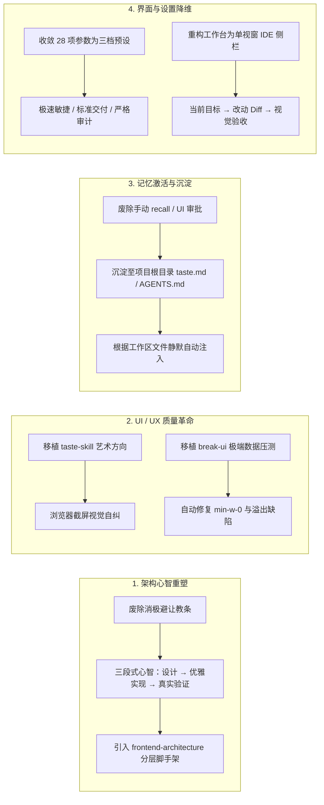

# 架构、品味（Taste）与系统机制演化调研

- **日期**：2026-11-10（Asia/Shanghai）
- **状态**：深度问题诊断、社区标杆调研与重构蓝图
- **范围**：Patchwork 编码 Agent 核心心智、记忆与提示词体系、工作台 UI/UX、设置体系及机制协同

---

## 1. 问题根因诊断：为什么 Patchwork 在真实编码中表现不佳？

全套 511 项单元与回归测试通过，仅证明了“系统的防御性规章制度在逻辑上没有自相矛盾”，但与真实开发者的编码体验存在严重割裂。

### 1.1 架构与设计能力缺失：“补丁心态（Patchwork Mindset）”锁死了重构
* **核心提示词诱导消极避让**：在 `assets/skills/patchwork/SKILL.md` 中反复强调：*“最小改动，保留既有模式，不做大范围重构，不为过 lint 改无关代码”*。
* **架构恶化循环**：当面对需要调整模块边界或引入新抽象的需求时，Agent 受到“最小改动”教条的强烈约束，不敢理顺架构，而是选择在已有代码上追加 `if-else` 特判。项目越改越腐化，技术债持续累积。
* **官僚审查挤占模型注意力**：模型在一个会话周期内的注意力和推理资源被大量繁文缛节占据（`inspect` → 填写 `brief` → 维护 `baseRevision` → 登记 `artifact` 绝对路径 → 检查避免独立 shell 使产物失效）。模型把 70% 的精力用于应付系统的审计机制，根本无暇推敲数据流、模块解耦、边界异常与类型契约。
* **架构技能空泛**：`assets/skills/architecture/SKILL.md` 仅有 23 行抽象口号（“输入 → 转换 → 副作用 → 输出”），缺乏现代软件架构模式、分层解耦与重构的实操脚手架。

### 1.2 记忆系统形同虚设：“抽屉里的死记忆”
* **默认明文禁用自动注入**：`src/memory/tool.mjs` 中写死 `No automatic injection into ordinary model context.`。用户的工程偏好和架构约定被锁在磁盘 JSON 数据库中，模型在日常生成代码时上下文根本不可见。
* **反常识的交互链路**：记忆提议后处于 `proposed` 态，必须由人类离开 Chat、在右侧栏多级 Tab 中手动翻找并点击“确认”；即使生效，模型也必须在没有线索的情况下盲猜关键词去调用 `recall` 工具。
* **与上下文完全脱节**：缺乏基于当前编辑文件路径与任务关键词的静默自动匹配注入，导致精心设计的 CAS 乐观锁和多版本数据库在实际编码中无法产生价值。

### 1.3 UI 审美与 UX 健壮性严重脱节
* **审美停留在底层调试终端**：侧栏工作台充斥着密密麻麻的小号等宽字体（10px~12px）、紧绷的边框线与抽象缩写代码（`AF`, `OP`, `EPR`, `OCC`, `TM`），视觉没有呼吸感和主次焦点，呈现的是 1990 年代硬件遥测监视器的极客陈腐感。
* **360px 宽度塞入 10 个独立视图**：设计了 6 个顶层 Tab + 4 组二级 Tab，信息层级过深，获取任务进展、主控队列和检索证据需要经历多次标签翻找。
* **以“Exit Code == 0”冒充完成**：系统仅检查命令是否非零退出，完全不感知真实渲染效果。界面文字挤压、重叠、溢出、空数据白屏等严重的 UI/UX 缺陷，被状态机轻易盖上“验收通过”的绿章。

### 1.4 设置项过度暴露内部实现
* **将学术论文超参数倾倒给用户**：`fields.mjs` 中的 28 个设置项充斥着普通开发者无法理解的内部变量（如 SoL-Pi 论文中用于测算 Token 效益的 `cacheWriteReadRatio: 12.5`、默认关闭的 EPR 约简器 3 个配置项、600000 毫秒这种未经转换的数值）。
* **缺乏场景化心智**：缺乏高层预设模式（敏捷/标准/严格），把架构调优的复杂度直接推给了最终用户。

### 1.5 功能割裂拼盘，缺少贯穿始终的主线
* 5 源免密钥爬虫、BM25 代码切片、代码图、5 个 SoL 机制、SQLite Superagent 队列、独立浏览器包、CAS 记忆库、独立 Worker 改进引擎——每个子系统各自为政。
* 搜索结果未沉淀为实现上下文，代码图 impact 未联动测试验收，记忆未约束生成 prompt，浏览器截图未反哺 UI 修复。系统呈现为前沿论文创意的拼盘怪，缺乏端到端闭环。

---

## 2. 社区先进标杆调研

针对上述问题，业界顶尖方案展现了截然不同的设计哲学：

### 2.1 Leonxlnx / taste-skill：艺术指导与真实视觉自省
* **项目定位**：赋予编码 Agent 审美“品味（Taste）”，取代千篇一律的通用 AI 塑料感页面。
* **核心机制**：
  1. **艺术方向前置（Art Direction First）**：写代码前必须先确立设计基调（极简、粗野派、有机质感、复古科技等），强制明确字偶阶梯、色彩对比度、微动效与负空间节奏，严禁直接套用低对比渐变与千篇一律的卡片网格。
  2. **视觉自检闭环（Visual Self-Correction）**：集成无头 Chromium DevTools，Agent 编码完成后自动截取渲染画面，自行比对视觉基准与控制台报错；若排版失衡或存在瑕疵，Agent 在向用户交卷前**自行打回重修**。
  3. **参考图谱（Reference Boards）**：内置真实优秀产品的样式资产库，Agent 对着高品味设计规范生成，而非靠统计概率猜测。

### 2.2 Emil Kowalski / break-ui：交互健壮性与极端破坏性压测
* **项目定位**：由顶级动效与前端工程师打造的界面破坏与极端边界压力测试技能。
* **核心机制**：
  1. **动态字段映射**：自动扫描组件所依赖的动态数据契约。
  2. **地狱级数据集注入（Worst-case Datasets）**：在交付前自动喂入超长无空格英文字符串、单字符超短名、0 数据空状态、海量大数字、Emoji 组合、非拉丁文字、Null / Undefined。
  3. **自动化 CSS 缺陷捕获与修复**：专打 Agent 编码通病（如缺失 `min-w-0` 导致 Flex 容器被撑破、文本未做省略截断、Grid 弹性变形、数字未做国际化格式化等），自动修复布局。
  4. **Demo / Worst-case 状态切换**：为页面注入实时对比开关，让开发者一键肉眼检验极端容错。

### 2.3 Command Code (`commandcode.ai`)：Taste 神经符号化学习与 Mods 体系
* **项目定位**：基于终端/桌面的 AI 编码 Agent，提出 `taste-1` 品味引擎与 Mods Hub。
* **核心机制**：
  1. **零摩擦静默学习（Zero-friction Taste Learning）**：摒弃繁琐的手动审批。后台持续观察用户的编辑、接受与撤销操作，提炼出人类可读的 `taste.md`。
  2. **模块化分发（`taste push` / `taste pull`）**：团队或个人可直接通过 CLI 拉取或发布风格包（如 `npx taste pull team/style`），跨项目共享偏好。
  3. **Mods 统一生命周期钩子**：所有功能扩展统一通过极简的 TypeScript 钩子（`cmd.on`, `cmd.hooks`, `cmd.addProvider`）接入，避免散乱的孤岛配置。

### 2.4 skills.sh 生态淘金：现代 Agent 技能最佳实践
* **`frontend-design`（Anthropic 官方）**：动工前强制选定美学基调（Brutalist, Maximalist, Luxury, Organic），从设计系统层面锁定 CSS 变量与空间排版。
* **`frontend-architecture`（we-are-singular）**：专门约束前端架构——领域分层、状态单一数据源（Single Source of Truth）、强类型 API 边界防腐层，禁止散乱的状态提升与反模式。
* **`taste-engine`（kennedys0）**：根据任务类型动态路由专属风格包，具备严格的视觉保真与材料契约。
* **`design-forge`（eskapeum）**：Awwwards 级别的网页设计系统契约驱动器。

---

## 3. 逐项横向对照矩阵

| 维度 | Patchwork 现状缺陷 | 社区标杆实践（Taste / Break-UI / Command Code / skills.sh） |
| :--- | :--- | :--- |
| **代码与架构** | 消极避让，死守“最小改动”导致技术债累积；架构技能仅 23 行口号。 | 架构先导与状态所有权约束；明确领域分层，鼓励规范重构，严禁无脑贴补丁。 |
| **UI 审美** | 10px 等宽密密麻麻的调试日志风格；`anti-slop` 只查文案废话，不懂视觉审美。 | 艺术方向前置（Art Direction）；利用无头 DevTools 进行**看图自检**，杜绝 AI 塑料感。 |
| **UX 健壮性** | 把 Exit Code 0 等同于交付合格，完全不管界面在极端数据下是否溢出白屏。 | 注入地狱级极端数据集（`break-ui`）；自动检测修复 `min-w-0`、文本截断与 Flex 畸变。 |
| **记忆沉淀** | 1000 行 CAS 数据库，默认强行禁用自动注入；需手动 UI 审批，形同虚设。 | 神经符号化自动沉淀（`taste.md`）；根据当前文件路径**静默、自动按需注入**。 |
| **设置与体验** | 28 项底层参数全平铺；用户需面对 `cacheWriteReadRatio`、毫秒数字等论文变量。 | 场景化预设收敛（敏捷/标准/严格）；机制由标准化 Skill 即插即用，零配置负担。 |
| **整体机制** | 7 个子系统各玩各的，缺乏端到端的主线流水线。 | 贯穿统一的流水线：**需求 → 架构设计 → 实现 → 视觉/破坏性压测 → 偏好沉淀**。 |

---

## 4. Patchwork 系统性演化重构蓝图

### 4.1 实施路线规划

1. **第一阶段：心智与架构解套**
   - 彻底重构 `assets/skills/patchwork/SKILL.md` 与 `assets/skills/architecture/SKILL.md`；
   - 拿掉“最小改动/不准大改”的束缚，引入模块分层、状态所有权以及清晰的设计先行（Architecture-First）脚手架。
2. **第二阶段：UI 品味与交互鲁棒性注入**
   - 重写 `web-ui` 技能，融合 `taste-skill` 的艺术方向指引；
   - 将 Playwright 浏览器插件能力打通至 UI 视觉自检与截图比对；
   - 增加类似 `break-ui` 的极端数据压力测试规范，拦截常见 CSS 布局崩溃。
3. **第三阶段：记忆系统盘活**
   - 改造 `src/memory/`：将项目偏好与代码习惯直接对齐到项目根目录的 `AGENTS.md` 或 `.patchwork/taste.md`；
   - 恢复上下文感知的静默自动注入，废除手动 approval 阻断。
4. **第四阶段：工作台 UI/UX 降维与预设收拢**
   - 彻底废除 6 顶层 + 4 二级的多层繁琐 Tab，打造现代简洁的单一主视窗（任务生命周期 → Diff 预览 → 验收凭据）；
   - 将 28 项底层复杂参数折叠，提供“敏捷模式”、“标准模式”、“严格审计模式”三档一键预设。
